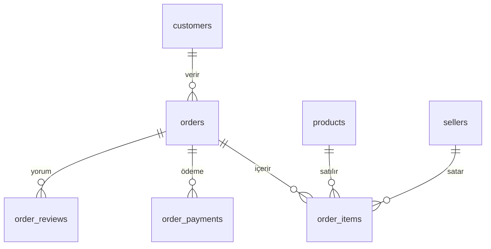
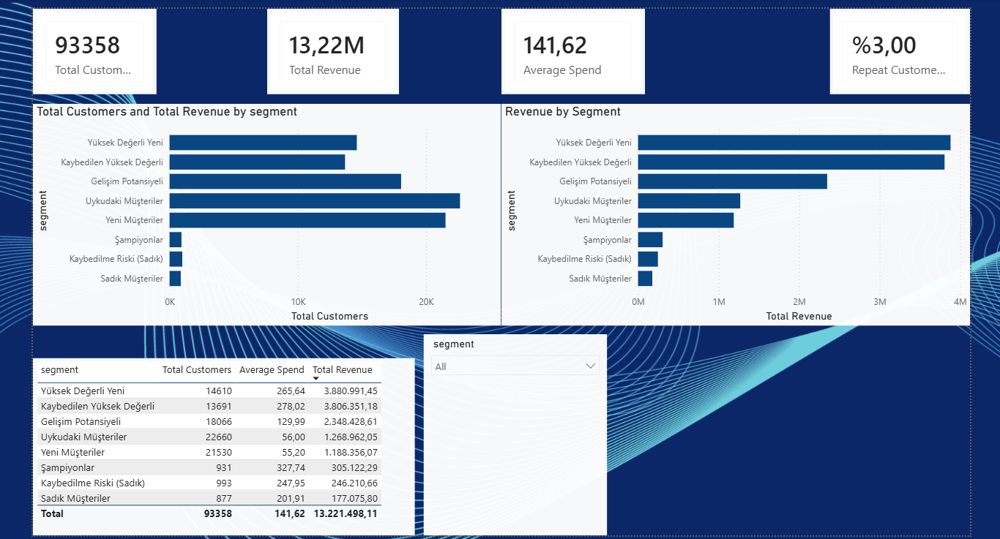
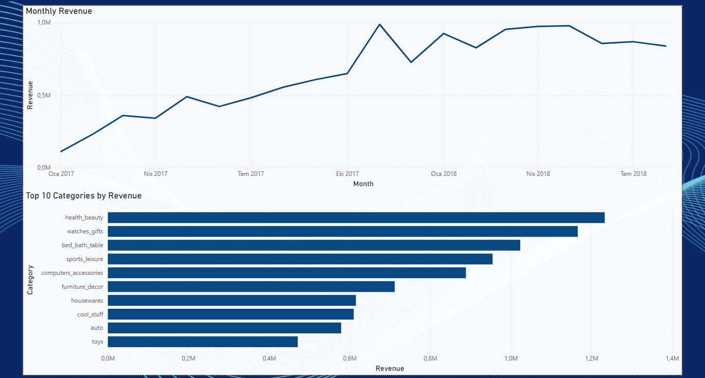

# Olist E-Ticaret Analizi: Müşteri Segmentasyonu (RFM) ve Teslimat Performansı

SQL Server ve Power BI ile hazırladığım bir veri analizi portföy projesi. Brezilyalı e-ticaret platformu Olist'in 2016-2018 arası gerçek (anonimleştirilmiş) sipariş verisi üzerinde satış trendlerini, müşteri segmentlerini ve teslimat performansının müşteri davranışına etkisini inceledim.

## Proje Amacı

Projede üç soruya cevap aradım:

1. Satışlar zaman içinde ve kategoriler bazında nasıl dağılıyor?
2. Müşteriler hangi segmentlere ayrılıyor ve gelirin büyük kısmı hangi segmentten geliyor?
3. Geç teslimat müşteri memnuniyetini ve müşterinin tekrar alışveriş yapmasını etkiliyor mu?

## Veri Seti

Kaggle'daki **Brazilian E-Commerce Public Dataset by Olist** kullanıldı (yaklaşık 99 bin sipariş, 9 CSV dosyası). Lisans koşulları için Kaggle sayfasına bakınız. Veri dosyaları bu repoya eklenmemiştir, Kaggle'dan indirilebilir. Para birimi veri setinde belirtilmemiştir, Brezilya şirketi olduğu için Brezilya reali (BRL) varsayılmıştır. Veri setindeki `geolocation` tablosu bu projede kullanılmadı.

## Kullanılan Araçlar

- SQL Server 2022 Express ve SSMS (T-SQL)
- Power BI Desktop (DAX ölçüleri)
- GitHub

## Veritabanı Şeması



Ayrıca `product_category_translation` tablosu, ürün kategorilerinin Portekizce adlarını İngilizceye çeviren bir arama tablosudur.

## Veri Yükleme Süreci (ETL)

CSV dosyaları önce SSMS'in *Import Flat File* sihirbazıyla `stg_` (staging) tablolarına ham haliyle yüklendi, sonra temizlenerek ana tablolara aktarıldı. Adımlar `sql/02_veri_yukleme.sql` dosyasında açıklanmıştır.

Yükleme sırasında yaşanan önemli bir sorun: Sihirbaz, Türkçe bölgesel ayar yüzünden fiyatlardaki noktayı binlik ayracı sanıp değerleri yanlış okudu (örneğin `134.97` değeri `13497` oldu). Aylık gelir grafiği gerçekçi olmayan değerler gösterince sorun fark edildi. Para sütunları metin olarak yeniden yüklenip `TRY_CAST` ile ondalık sayıya çevrilerek düzeltildi. Düzeltme, bilinen değerlerle doğrulandı (en yüksek ürün fiyatı 6735.00, toplam ürün geliri 13.591.643,70).

## Veri Kalitesi Kontrolleri

| Kontrol | Bulgu | Karar |
|---|---|---|
| Sipariş durumları | 96.478 sipariş (%97) `delivered`; kalanı iptal, stokta yok veya süreç içinde | Gelir ve müşteri analizlerinde yalnızca `delivered` siparişler |
| Durumu `delivered` olup teslim tarihi boş | 8 sipariş | Teslimat analizinde hariç tutuldu |
| Kategorisiz ürün | 610 ürün (yaklaşık %1,9) | "bilinmiyor" kategorisiyle tutuldu |
| Çevirisi olmayan kategori | 2 kategori (`pc_gamer`, `portateis_cozinha_e_preparadores_de_alimentos`) | Çeviriler elle eklendi |
| Çeviri tablosunda başlık satırı | 1 satır veri olarak yüklenmişti | Silindi (71 kategori kaldı) |
| Para sütunlarında ondalık hatası | Fiyatlar yaklaşık 100 kat şişmişti | Metin olarak yüklenip `TRY_CAST` ile düzeltildi |
| Bir siparişin birden fazla yorumu | Birleştirmede satır çoğalması riski | Yorumlar sipariş başına tek puana indirildi |

## Analizler ve Bulgular

### 1. Satış trendi

- 2017 boyunca düzenli büyüme var. **Kasım 2017'de aylık gelir yaklaşık 1 milyon** ile zirveye çıkıyor (muhtemelen Black Friday etkisi), Aralık 2017'de düşüyor.
- 2018'de aylık gelir yatay seyrediyor. Veri Ağustos 2018'de bitiyor. 2016 verisi çok seyrek olduğu için grafiklerden çıkarıldı.
- Gelire göre en büyük kategoriler: `health_beauty`, `watches_gifts`, `bed_bath_table`, `sports_leisure` ve `computers_accessories`.

### 2. Müşteri segmentasyonu (RFM)

RFM; müşterileri son alışveriş zamanı (Recency), alışveriş sıklığı (Frequency) ve toplam harcama (Monetary) ile puanlar. Müşteri, `customer_unique_id` ile sayıldı, çünkü Olist'te her sipariş için yeni bir `customer_id` üretiliyor. R ve M `NTILE(5)` ile 1-5 puanlandı. Frekansta `NTILE` kullanılmadı: müşterilerin %97'si tek sipariş verdiği için eşit bölme anlamsız olurdu, bunun yerine sabit eşik kullanıldı (1 sipariş = 1, 2 sipariş = 3, 3+ sipariş = 5).

| Segment | Müşteri | Ort. harcama | Toplam gelir | Gelir payı |
|---|---|---|---|---|
| Yüksek Değerli Yeni | 14.610 | 265,64 | 3.880.991 | %29,4 |
| Kaybedilen Yüksek Değerli | 13.691 | 278,02 | 3.806.351 | %28,8 |
| Gelişim Potansiyeli | 18.066 | 129,99 | 2.348.429 | %17,8 |
| Uykudaki Müşteriler | 22.660 | 56,00 | 1.268.962 | %9,6 |
| Yeni Müşteriler | 21.530 | 55,20 | 1.188.356 | %9,0 |
| Şampiyonlar | 931 | 327,74 | 305.122 | %2,3 |
| Kaybedilme Riski (Sadık) | 993 | 247,95 | 246.211 | %1,9 |
| Sadık Müşteriler | 877 | 201,91 | 177.076 | %1,3 |

**Temel bulgular:**

- Teslim edilen siparişlerde 93.358 benzersiz müşteri var ve **%97'si (90.557 kişi) yalnızca bir kez alışveriş yapmış**.
- Gelirin **%58'i** iki segmentten geliyor ve ikisi de tek seferlik alıcılardan oluşuyor: Yüksek Değerli Yeni ve Kaybedilen Yüksek Değerli.
- Tekrar alan müşteri segmentleri (Şampiyonlar, Sadık, Kaybedilme Riski) toplam gelirin yalnızca %5,5'ini oluşturuyor.
- En kalabalık iki segment (Uykudaki ve Yeni Müşteriler) müşterilerin yaklaşık %47'si, ama gelirin yalnızca yaklaşık %18,6'sı.

### 3. Teslimat performansı ve memnuniyet

Genel durum (96.470 sipariş): ortalama teslimat **12,5 gün**, platformun verdiği ortalama tahmini süre **24,4 gün**, gecikme oranı **%6,8**, ortalama puan **4,16**.

**Gecikmenin puana etkisi:**

| Grup | Sipariş | Ort. puan | Düşük puan (1-2) oranı |
|---|---|---|---|
| Zamanında veya erken | 89.936 | 4,29 | %9,2 |
| 1-3 gün geç | 1.870 | 3,29 | %32,2 |
| 4-7 gün geç | 1.802 | 2,11 | %67,6 |
| 8+ gün geç | 2.862 | 1,70 | %79,2 |

Sadece 1-3 gün gecikme bile ortalama puanı yaklaşık 1 puan düşürüyor, gecikme arttıkça puan düzenli olarak azalıyor.

**Eyalet bazlı gecikme (en az 500 siparişi olan, gecikme oranına göre ilk 10):**

| Eyalet | Sipariş | Ort. teslimat (gün) | Gecikme oranı | Ort. puan |
|---|---|---|---|---|
| MA | 717 | 21,5 | %17,4 | 3,83 |
| CE | 1.279 | 21,2 | %13,8 | 3,94 |
| BA | 3.256 | 19,3 | %12,2 | 3,93 |
| RJ | 12.350 | 15,2 | %12,1 | 3,97 |
| PA | 946 | 23,7 | %11,2 | 3,91 |
| ES | 1.995 | 15,7 | %10,7 | 4,08 |
| PB | 517 | 20,4 | %10,4 | 4,08 |
| MS | 701 | 15,5 | %9,7 | 4,16 |
| PE | 1.593 | 18,4 | %9,6 | 4,08 |
| SC | 3.546 | 14,9 | %8,2 | 4,13 |

Kuzey ve kuzeydoğu eyaletlerinde (MA, CE, BA, PA, PB, PE) teslimat süresi 18-24 gün ve gecikme oranı genel ortalamanın üstünde. Rio de Janeiro (RJ) ayrı bir durum: teslimat süresi kısa (15,2 gün) ama gecikme oranı yüksek, hacmi de büyük olduğu için bu on eyalet arasında toplam geç sipariş sayısında ilk sırada (yaklaşık 1.500 sipariş, oran ve sipariş sayısından hesaplanmış yaklaşık değer). Bunun nedeni (kargo firması, tahmin süresi, satıcı konumu) bu veriyle ayırt edilemiyor.

**Tekrar alım analizi** (ilk siparişi 2018 öncesi olan 42.393 müşteri, hepsine en az 8 ay süre tanınmıştır):

| İlk sipariş | Müşteri | Tekrar alım oranı |
|---|---|---|
| Zamanında teslim edildi | 40.004 | %4,25 |
| Geç teslim edildi | 2.389 | %2,72 |

**Eyalet bazında kontrol** (en büyük 3 eyalet, aynı müşteri grubu):

| Eyalet | İlk sipariş | Müşteri | Tekrar alım oranı |
|---|---|---|---|
| SP | Zamanında | 16.004 | %4,52 |
| SP | Geç | 636 | %2,99 |
| RJ | Zamanında | 5.223 | %4,63 |
| RJ | Geç | 603 | %1,66 |
| MG | Zamanında | 4.983 | %4,15 |
| MG | Geç | 142 | %1,41 |

Geç teslim edilen ilk siparişlerde tekrar alım oranı üç eyalette de daha düşük.
Bu, farkın yalnızca eyaletler arası farktan kaynaklanmadığını destekliyor.
Rio de Janeiro'da fark en net (%4,63 yerine %1,66), São Paulo'da daha küçük.
Minas Gerais'te geç grupta yalnızca 142 müşteri ve yaklaşık 2 tekrar alan var,
bu yüzden o sonuç güvenilir değil.

| İlk siparişin puanı | Müşteri | Tekrar alım oranı |
|---|---|---|
| Düşük (1-2) | 5.101 | %3,61 |
| Orta (3) | 3.606 | %4,13 |
| Yüksek (4-5) | 33.368 | %4,25 |
| Yorum yok | 318 | %4,40 |

**Temel bulgular:**

- İlk siparişi geç gelen müşteriler yaklaşık **üçte bir daha az** geri dönüyor (%4,25 yerine %2,72).
- Ancak geç teslimat alan müşteriler tüm müşterilerin yalnızca yaklaşık %5,6'sı. Bu müşteriler de zamanında teslim alanlar kadar geri dönseydi tekrar alan sayısı 1.765'ten yaklaşık 1.800'e çıkardı.
- **Zamanında teslim alan, memnun müşterilerin bile yaklaşık %96'sı geri dönmüyor.** Düşük tekrar alımın temel nedeni gecikme ya da memnuniyetsizlik gibi görünmüyor.
- Tahmini teslimat süresi gerçek süreden yaklaşık iki kat uzun. Bu yüzden %6,8'lik gecikme oranı gerçekte yaşanan beklemeyi olduğundan düşük gösteriyor olabilir.

İlk hipotezim gecikmenin müşteri kaybının ana nedeni olduğuydu. Veriyle test ettiğimde etkisi gerçek ama küçük çıktı. Asıl sorun, ilk alışverişten sonra müşteriyi geri getirecek bir mekanizmanın olmaması gibi görünüyor. Bu bir hipotezdir, veri setiyle doğrulanamaz.

## Öneriler

- İlk alışverişten sonra ikinci alışverişi teşvik eden kampanyalar. Öncelikli hedef: "Yüksek Değerli Yeni" segmenti.
- "Kaybedilen Yüksek Değerli" segmentine geri kazanma kampanyası.
- Geç kalan siparişlerde müşteriye proaktif bilgilendirme ve küçük bir tazminat.
- Daha gerçekçi teslimat tahminleri. Çok geniş tahmin gecikmeyi gizliyor.
- Gecikme iyileştirmesinde önce hacmi ve gecikme oranı yüksek eyaletlere (özellikle Rio de Janeiro) odaklanma.
- Düşük değerli segmentlere (Uykudaki, Yeni) pahalı kampanya yerine düşük maliyetli otomatik iletişim.

## Sınırlamalar

- Veri 2016-2018 arasını kapsıyor, bugünkü müşteri davranışını yansıtmayabilir.
- Gelir hesaplarında yalnızca ürün fiyatı kullanıldı (kargo ücreti dahil değil), yalnızca teslim edilen siparişler alındı.
- "Kaybedilen" segment, müşterinin gerçekten kaybedildiğini değil, verinin bittiği tarihe göre uzun süredir alışveriş yapmadığını gösterir.
- Gecikme, platformun verdiği tahmini tarihe göre tanımlandı.
- Bulgular ilişkiyi gösterir, kesin neden-sonuç ilişkisi kanıtlamaz. Gecikme etkisi en büyük üç eyalette ayrı ayrı incelendiğinde de görüldü, ama aynı eyalet içindeki
  şehir, ürün türü veya satıcı farkları gibi diğer etkenler kontrol edilmedi.
- Mutsuz müşteriler yorum bırakmaya daha yatkın olabilir, bu yüzden puan analizleri memnuniyetsizliği biraz abartıyor olabilir. Yorum bırakmayan siparişler puan analizlerine dahil değil.
- Tekrar alım analizi için ilk siparişi 2018 öncesi olan müşteriler alındı.

## Kullanılan SQL Teknikleri

- Veritabanı tasarımı: primary key, foreign key, ER ilişkileri
- ETL: staging tabloları, `TRY_CAST` ile veri tipi dönüşümü, veri temizleme
- `JOIN`, `LEFT JOIN`, `GROUP BY`, `HAVING`, `CASE`, `COALESCE`
- CTE (`WITH`), view'lar
- Pencere fonksiyonları: `NTILE`, `ROW_NUMBER`, `COUNT() OVER`, `SUM() OVER`
- Tarih fonksiyonları: `DATEDIFF`, `DATEADD`, `DATEFROMPARTS`
- Power BI: SQL Server bağlantısı, DAX ölçüleri, dashboard tasarımı

## Proje Yapısı

```
olist-eticaret-analizi/
├── README.md
├── sql/
│   ├── 01_tablolari_olustur.sql
│   ├── 02_veri_yukleme.sql
│   ├── 03_veri_kalitesi.sql
│   ├── 04_viewlar.sql
│   ├── 05_satis_analizi.sql
│   ├── 06_rfm.sql
│   └── 07_teslimat_analizi.sql
└── dashboard/
    ├── olist_dashboard.pbix
    ├── musteri_segmentasyonu.png
    └── teslim_edilen_satislar.png
```

## Dashboard





## Nasıl Çalıştırılır

1. Veri setini Kaggle'dan indirin ve CSV dosyalarını bilgisayarınıza çıkarın.
2. SQL Server Express ve SSMS'i kurun.
3. `sql/` klasöründeki dosyaları numara sırasıyla çalıştırın. `02_veri_yukleme.sql` dosyasının başındaki açıklamayı izleyerek CSV'leri önce `stg_` tablolarına yükleyin.
4. Power BI Desktop'ta `olist_dashboard.pbix` dosyasını açın ve SQL Server bağlantısını kendi sunucu adınıza göre güncelleyin.

## İletişim

Bilgehan Bektaş | Akdeniz Üniversitesi, Yönetim Bilişim Sistemleri | https://www.linkedin.com/in/bilgehan-bekta%C5%9F-905ab0384/
